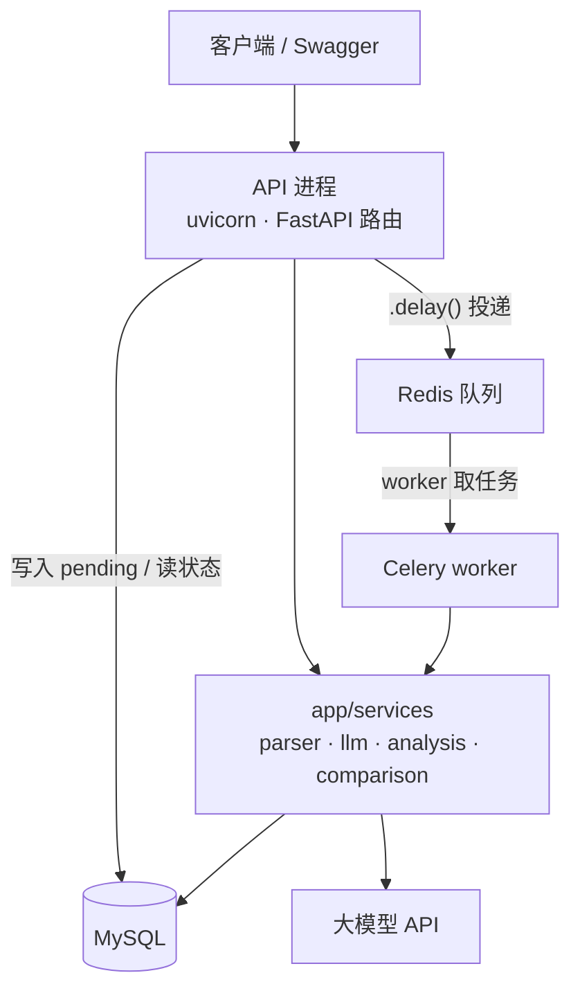
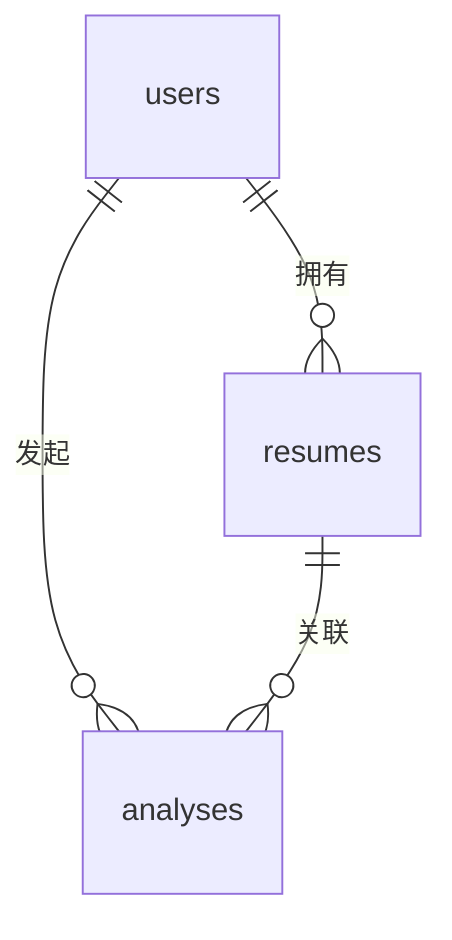

# AI 简历分析

上传一份 PDF / DOCX 简历，调用大模型输出结构化评分：简历完整度、内容质量、岗位匹配度，以及按优先级排序的修改建议。

FastAPI + SQLAlchemy + MySQL + Redis + Celery。上传和查询是同步的，耗时几十秒的模型调用交给独立 worker 异步执行。

> 个人学习项目，接口契约、Prompt 和表结构都还在迭代，不保证向后兼容。

## 实现进度

| 阶段 | 内容 | 状态 |
|---|---|---|
| 0 | 项目骨架、配置加载、数据库会话、健康检查 | 已完成 |
| 1 | 注册登录、JWT 鉴权、资源归属校验 | 已完成 |
| 2 | 简历上传、文件校验、列表与删除 | 已完成 |
| 3 | PDF / DOCX 文本提取与清洗 | 已完成 |
| 4 | 大模型接入：Prompt、输出校验、重试、mock | 已完成 |
| 5 | 分析接口：提交、轮询、历史列表 | 已完成 |
| 6 | Celery 异步化：202 + 任务队列 + 两层超时 | 已完成 |
| 7 | 历史对比：分数走势与建议差异 | 已完成 |
| 8 | OpenAPI 文档：错误码、示例、401 文案统一 | 已完成 |

后端到此为止。**前端还没做** —— 现在能看到的 `/docs` 是 FastAPI 自动生成的调试页，不是产品界面。

## 功能

- 邮箱注册 / 登录，JWT 鉴权（bcrypt 存密码）
- 上传 PDF / DOCX，服务端解析出纯文本入库（扩展名 + 魔数双校验，5 MB 上限）
- 提交分析任务后**立即返回 202**，worker 后台调用模型，前端轮询状态
- 分析结果结构化存储：总分、各栏目检查、建议列表、模型名、Prompt 版本
- 支持传入目标岗位 JD，输出岗位匹配度
- **历史对比**：同一份简历多次分析的分数走势，以及两次分析之间的建议变化（新增 / 已解决 / 仍存在）
- 全部资源按用户隔离，越权访问统一返回 404 而不是 403，不泄露资源是否存在
- 14 个接口的 OpenAPI 文档齐全：每个错误码都有说明和响应示例，`/docs` 可以直接当接口说明书用
- `mypy` 全量通过（34 个文件，开了 `warn_unused_ignores`、`strict_equality` 等严格选项）

## 技术栈

| 层 | 选型 |
|---|---|
| Web | FastAPI 0.162 · Uvicorn |
| 数据 | SQLAlchemy 2.1 · MySQL 8（utf8mb4）· PyMySQL |
| 队列 | Celery 5.6 · Redis 7+ |
| 校验 | Pydantic 2 · pydantic-settings |
| 模型 | OpenAI 兼容接口（默认 DeepSeek），内置 `mock` 模式可离线跑通全流程 |
| 解析 | pdfplumber · python-docx |
| 检查 | mypy（`requirements-dev.txt`，不进生产依赖） |

## 架构

两个进程，一套业务代码：



`app/services` 被两个进程共同 import，这是把业务从 `tasks.py` 里抽出来的原因：抽完之后任务层只剩 75 行，全是 `SessionLocal()`、`close()` 和捕获超时信号。想批量重跑历史分析，`for` 循环调 `execute_analysis(db, id)` 就行，不用起 Redis。

各层的边界规则：

| 层 | 文件 | 只准做 | 不做 |
|---|---|---|---|
| 路由 | `api/routes/*.py` | 找数据、调服务、写库 | 拼 Prompt、判 `if LLM_PROVIDER` |
| 依赖 | `api/deps.py` | token → User | 任何业务判断 |
| 服务 | `services/*.py` | 纯业务 | 开 Session、碰 HTTP、import Celery |
| 任务 | `workers/tasks.py` | 进程生命周期 | 业务逻辑 |
| 模型 | `models/*.py` | 表结构 | 业务规则 |
| 校验 | `schemas/*.py` | 出入口形状 | 查库 |

## 请求是怎么走的

```
POST /resumes/{id}/analyses
  |
  +-- 1. 写入一条 status=pending 的记录  --------->  MySQL
  +-- 2. run_analysis.delay(id)  ----------------->  Redis 队列
  +-- 3. 立刻返回 202 + status=pending

                    Redis 队列
                        |  worker 取走
                        v
                 UPDATE status=running  ------------->  MySQL
                 调用大模型（10 ~ 90 秒）
                 UPDATE status=done / failed  ------->  MySQL

GET /analyses/{id}
  +-- 读 status（pending / running / done / failed） --->  MySQL
```

两条约定：

1. **消息体里只有 `analysis_id`**，简历正文由 worker 自己查库 —— 两万字的正文不该塞进 Redis。
2. **状态的唯一事实来源是 MySQL 的 `status` 列**，Redis 里不存结果副本，避免两边不一致时不知道该信谁。

## 快速开始

### 1. 前置依赖

- Python 3.12+
- MySQL 8（要求 `utf8mb4`，简历里有 emoji 也不会炸）
- Redis 7+

没有 MySQL / Redis 的话，用 Docker 起一个：

```bash
docker run -d --name mysql -p 3306:3306 \
  -e MYSQL_ROOT_PASSWORD=your-root-password \
  -e MYSQL_DATABASE=resume_db \
  -e MYSQL_USER=resume \
  -e MYSQL_PASSWORD=your-password \
  mysql:8.0 --character-set-server=utf8mb4 --collation-server=utf8mb4_0900_ai_ci

docker run -d --name redis -p 6379:6379 redis:7-alpine
```

不想暴露 3306 的话，仓库里的 `docker-compose.yml` 用的是 3307 端口，`docker compose up -d` 即可。

### 2. 装依赖

```bash
python -m venv .venv
source .venv/bin/activate          # Windows: .venv\Scripts\activate
pip install -r requirements.txt
```

### 3. 配置环境变量

```bash
cp .env.example .env
# Windows PowerShell: copy .env.example .env
```

至少要改这三处：

| 变量 | 说明 |
|---|---|
| `SECRET_KEY` | `python -c "import secrets;print(secrets.token_urlsafe(48))"` 生成 |
| `DATABASE_URL` | 必须是 `mysql+pymysql://` 前缀，密码里的 `@ : /` 要做 URL 编码 |
| `LLM_API_KEY` | 用 `LLM_PROVIDER=mock` 时可以不填 |

### 4. 建库建表

库要先建好，表由脚本创建。登录 MySQL（`mysql -uroot -p`）后执行：

```sql
CREATE DATABASE resume_db DEFAULT CHARACTER SET utf8mb4 COLLATE utf8mb4_0900_ai_ci;
CREATE USER 'resume'@'%' IDENTIFIED BY 'your-password';
GRANT ALL PRIVILEGES ON resume_db.* TO 'resume'@'%';
```

```bash
python -m app.db.init_db
```

`create_all` 只建不存在的表，**不会改已有表结构**。改字段要手动 ALTER 或上 Alembic。

### 5. 启动（两个终端）

```bash
# 终端 1：API
uvicorn app.main:app --reload

# 终端 2：worker
celery -A app.workers.celery_app:celery_app worker -l info -P solo
```

Windows 必须加 `-P solo`（或 `-P threads`），Celery 的 prefork 模型在 Windows 上不可用。

**只起 API 不起 worker，分析记录会永远停在 `pending`** —— 这是异步系统的正常表现，不是 bug。

### 6. 试一试

- Swagger：<http://127.0.0.1:8000/docs>，点右上角 Authorize 填 `access_token`
- 命令行：用 `test_main.http`（PyCharm / IntelliJ HTTP Client），按顺序点绿色箭头即可，`token` / `resume_id` / `analysis_id` 会自动串起来

验证链路是否通畅：

```bash
curl http://127.0.0.1:8000/health
# {"status":"ok","version":"0.1.0","debug":true}
```

如果本机开了全局代理，curl 访问 127.0.0.1 可能被代理拦成 502，加 `--noproxy '*'`。

## 配置项

全部来自 `.env`，由 `app/core/config.py` 统一加载。必填项缺失时**导入即报错**，不会带着错误配置跑起来。

| 分组 | 变量 | 默认值 | 说明 |
|---|---|---|---|
| 应用 | `APP_NAME` | `Resume Analyzer API` | 显示在 `/docs` 顶部 |
| | `APP_VERSION` | `0.1.0` | 由 `/health` 返回 |
| | `DEBUG` | `true` | 透传到 `/health`，不影响日志级别 |
| 安全 | `SECRET_KEY` | **必填** | JWT 签名密钥，少于 32 字符直接报错 |
| | `ALGORITHM` | `HS256` | |
| | `ACCESS_TOKEN_EXPIRE_MINUTES` | `1440` | 24 小时 |
| 数据库 | `DATABASE_URL` | 见 `.env.example` | 必须以 `mysql+pymysql://` 开头，有校验器拦 |
| | `DB_ECHO` | `false` | 打开后每条 SQL 打印到控制台 |
| 上传 | `UPLOAD_DIR` | `uploads` | 相对路径按项目根目录解析 |
| | `MAX_UPLOAD_MB` | `5` | 边读边累加，超限立刻中断 |
| 队列 | `REDIS_URL` | `redis://localhost:6379/0` | broker 和 backend 共用同一个库 |
| 模型 | `LLM_PROVIDER` | `mock` | `mock` 或 `openai`，Literal 类型，写错启动就报错 |
| | `LLM_API_KEY` | 空 | `LLM_PROVIDER=openai` 时必填 |
| | `LLM_BASE_URL` | `https://api.deepseek.com/v1` | 任何 OpenAI 兼容地址 |
| | `LLM_MODEL` | `deepseek-chat` | |
| | `LLM_TIMEOUT` | `90` | 单次请求超时（秒），直接决定 Celery 的软/硬超时 |
| | `LLM_MAX_RETRIES` | `2` | 内部重试次数，共尝试 3 次 |
| | `LLM_TEMPERATURE` | `0.2` | 压低是为了打分可复现 |
| | `LLM_MAX_TOKENS` | `2048` | |
| | `LLM_MAX_INPUT_CHARS` | `20000` | 送进模型前的硬上限，超出截断并追加提示 |

改 `LLM_TIMEOUT` 或 `LLM_MAX_RETRIES` 要注意：Celery 的软超时按 `LLM_TIMEOUT × (MAX_RETRIES + 1) + 30` 算出来，改完不需要手工同步，但**必须重启 worker** 才生效。

## 接真实模型

默认 `LLM_PROVIDER=mock`：不联网、不花钱，结果由正文内容决定，**同样输入永远同样输出**。字段名、取值范围和真实模型完全一致，所以整条链路（含数据库里已有的记录）在切换后都不受影响 —— 这也是阶段 5、6 全程能用 mock 开发的原因。

换真实通道只改配置，代码一行不动：

```bash
LLM_PROVIDER=openai
LLM_API_KEY=sk-xxxxxxxx
LLM_BASE_URL=https://api.deepseek.com/v1
LLM_MODEL=deepseek-chat
```

任何 OpenAI 兼容接口都能用（DeepSeek / 通义 / Kimi / 本地 vLLM），通常只需要改 `LLM_BASE_URL` 和 `LLM_MODEL`。

配了 `openai` 却没给 key 时，应用会在**启动阶段**就报错，不会等到第一个分析请求打进来才 401 —— 那时候排查很容易怀疑到网络和额度上去。

## 接口一览

| 方法 | 路径 | 说明 | 成功状态码 |
|---|---|---|---|
| GET | `/health` | 健康检查 | 200 |
| POST | `/auth/register` | 注册 | 201 |
| POST | `/auth/login` | 登录（JSON） | 200 |
| POST | `/auth/token` | 登录（OAuth2 表单，`username` 填邮箱） | 200 |
| GET | `/auth/me` | 当前用户 | 200 |
| POST | `/resumes` | 上传并解析简历 | 201 |
| GET | `/resumes` | 我的简历列表 | 200 |
| GET | `/resumes/{id}` | 简历详情（正文前 500 字） | 200 |
| DELETE | `/resumes/{id}` | 删除简历（级联删文件与分析记录） | 204 |
| POST | `/resumes/{id}/analyses` | 提交分析（异步） | **202** |
| GET | `/resumes/{id}/analyses` | 某份简历的分析历史 | 200 |
| GET | `/resumes/{id}/analyses/trend` | 分数走势（折线图数据） | 200 |
| GET | `/resumes/{id}/analyses/compare` | 对比两次分析 | 200 |
| GET | `/analyses/{id}` | 分析结果 / 轮询状态 | 200 |

除 `/health`、`/auth/register`、两个登录接口外，其余都需要 `Authorization: Bearer <token>`。

### 状态码约定

| 码 | 场景 |
|---|---|
| 400 | 简历正文为空，无法分析；对比时两个 id 相同 |
| 401 | 未带 token、token 无效、密码错误 |
| 404 | 资源不存在**或不属于当前用户**（统一按不存在处理） |
| 409 | 邮箱已被注册；拿未完成（pending / running / failed）的分析做对比 |
| 413 | 上传文件超过 5 MB |
| 415 | 扩展名或文件魔数不是 PDF / DOCX |
| 422 | 请求体字段校验失败 |
| 503 | 任务队列不可用（Redis 挂了），可退避重试 |

模型调用失败**不会**变成 HTTP 错误码。分析已经异步化了，请求早就返回 202，失败只能体现在 `status=failed` 和 `error_message` 里 —— 客户端该盯的是这两个字段，不是 HTTP 状态码。

## 目录结构

```
app/
├── main.py               FastAPI 实例、中间件、路由注册
├── api/
│   ├── deps.py           get_current_user：JWT -> User
│   ├── openapi.py        tag 说明与标准错误响应（文档素材，不含逻辑）
│   └── routes/           auth / resumes / analyses 三组端点，14 个接口
├── core/
│   ├── config.py         Settings，环境变量的唯一来源
│   └── security.py       密码哈希、JWT 签发与校验
├── db/
│   ├── session.py        engine、连接池、SessionLocal
│   └── init_db.py        建表脚本
├── models/               SQLAlchemy 表定义
│   ├── user.py           users：邮箱唯一，密码只存 bcrypt 哈希
│   ├── resume.py         resumes：原文件名 + UUID 落盘名 + 解析后的正文
│   └── analysis.py       analyses：状态机、result JSON、模型与 Prompt 版本
├── schemas/              Pydantic 入参 / 出参
│   ├── user.py           注册、登录、token、用户信息
│   ├── resume.py         上传响应、列表、详情（正文截前 500 字）
│   ├── analysis.py       分析入参、结果结构、列表与详情
│   ├── comparison.py     对比与走势的出参模型
│   └── system.py         健康检查出参
├── services/             业务逻辑，不认识 FastAPI 也不认识 Celery
│   ├── parser.py         PDF / DOCX -> 纯文本
│   ├── prompts.py        Prompt 与版本号
│   ├── llm.py            调模型、解析与校验输出、重试
│   ├── analysis.py       一次分析的完整编排，可同步调用
│   └── comparison.py     两次分析的差异计算，纯函数
└── workers/
    ├── celery_app.py     Celery 实例与配置
    └── tasks.py          任务薄壳：Session 生命周期 + 超时信号
```

分层的意义：`services/` 里的东西既能被路由调用，也能被 worker 调用，还能被脚本和单元测试直接调用 —— 想批量重跑历史分析，`for` 循环调 `execute_analysis(db, id)` 就行，不用起 Redis。

## 数据模型

三张表，全部 `ON DELETE CASCADE`，删用户会连带删简历和分析：



| 表 | 关键字段 | 说明 |
|---|---|---|
| `users` | `email`（唯一索引）、`hashed_password`、`is_active` | 只存认证必需的信息，任何情况下不落明文密码 |
| `resumes` | `original_filename`、`stored_filename`（UUID，唯一）、`raw_text`、`char_count` | 文件名和磁盘名解耦，避免同名覆盖和 `../` 穿越 |
| `analyses` | `status`、`result`（JSON）、`match_score`、`model_name`、`prompt_version`、三个时间戳 | `created_at` / `started_at` / `finished_at` 之差分别是排队耗时和执行耗时 |

几个刻意的冗余：

- **`raw_text` 单独存一份**。分析时直接查库取用，不必每次重新解析 PDF —— 解析一份 PDF 要一两秒，而这份简历可能被分析几十次。
- **`result` 用 JSON 列而不是拆成十几个字段**。Prompt 的输出结构还在迭代，拆成列意味着每改一次 Prompt 就要改一次表结构；JSON 列只改 Pydantic 模型。
- **`match_score` 从 JSON 里单独抽成一列**。列表页要按匹配度排序，而 SQLite 的 JSON 函数能力有限、跨库也不通用，冗余一个 int 更省事。
- **`analyses.user_id` 冗余一列**。通过 `resume_id` 能关联出用户，但「查我的所有分析记录」是最高频查询，冗余能省掉一次 join；简历被删后记录也还能独立追溯。
- **`prompt_version` 在提交时就写**。等 worker 成功后再补的话，失败记录会落成建表时的默认值 `v1` —— 一个这次运行里从未存在过的版本号。

时间字段全存 UTC。混用本地时会算出负的排队时间。

## 关键设计

**异步而不丢任务**：提交时先落一条 `pending` 记录再 `.delay()`。顺序反过来的话，worker 可能在记录还不存在时就开始跑。任务开了 `acks_late`，worker 中途被杀消息会重新投递，所以 `execute_analysis` 里做了幂等判断（已是 `done` 就跳过）。

**两层超时**：Celery 的 soft limit 300 秒先抛 `SoftTimeLimitExceeded`，任务捕获后把记录标成 `failed` 再退出；hard limit 330 秒由 worker 直接杀进程，兜住「异常处理里又卡住」的情况。这两个值必须大于 `LLM_TIMEOUT × (LLM_MAX_RETRIES + 1)`，否则会误杀还在正常重试的请求。

**连接池**：`pool_pre_ping` + `pool_recycle=3600` 应付 MySQL 的 `wait_timeout`；prefork 模式下子进程会在 `worker_process_init` 里 `engine.dispose(close=False)`，否则多个进程共用同一个 TCP 连接，会出现只在高并发下才犯的「Packet sequence number wrong」。

**上传六步**：扩展名 → 累加大小 → 魔数 → 落盘 → 解析 → 写库。后三步任一失败都要删掉已落盘的文件，否则磁盘会被垃圾文件慢慢堆满。

**输出容错分层**：数值越界钳制（105 → 100）、枚举拼错归一化（`urgent` → `high`）、列表过长截断，只有「不是 JSON」「缺必填字段」才触发重试 —— 目的是把重试次数压到最低，每次重试都在烧 token。

**建议的模糊匹配**：对比两次分析时，判断「这条建议上次也有」用的是 `difflib.SequenceMatcher` 的字符级相似度，阈值 0.55。去掉标点和空白后比较，因为模型两次输出的标点几乎不可能一致。0.55 这个位置：同一个问题改了措辞通常落在 0.6~0.8，话题相近但内容不同的两个问题通常在 0.4 以下。选字符级而不是分词，是因为中文没有空格，而引入分词库只为做一次比较并不划算。

**对比不落库**：`trend` 和 `compare` 完全由已有的 `result` JSON 现算，不新增表、不缓存。代价是每次请求都要把 JSON 反序列化再校验一遍，收益是改算法时历史数据自动跟上 —— 如果把 diff 结果存表，算法一升级，旧记录就永远是新旧混杂的。目前一份简历几十次分析的规模，现算的开销可以忽略。

**为什么 409 而不是 400**：拿 `pending` 的分析做对比，请求本身没写错，是资源当前状态不允许这个操作。前端拿到 409 应该提示「等分析跑完再看」，拿到 400 则会以为参数填错了。

**错误码进文档**：FastAPI 默认只把成功码和 422 写进 OpenAPI，客户端想知道「什么时候返回 409」只能翻源码。`api/openapi.py` 把每个错误码的描述和响应示例集中定义成常量，路由里 `responses={**AUTH_REQUIRED, 404: NOT_FOUND_RESUME}` 引用 —— 14 个端点共用一份措辞，不会出现「这个接口写『无效凭证』、那个写『认证失败』」的漂移。422 刻意不覆盖，框架自动生成的那份带着字段级的 `loc` / `msg` / `type`，比手写的示例信息量大。

**401 文案统一在中文**：`OAuth2PasswordBearer` 默认会在「没带 Authorization 头」时自己抛 401，文案是写死的英文 `Not authenticated`。传 `auto_error=False` 把这一步收回 `get_current_user` 里，全站 401 只有三种文案（未提供身份凭证 / 无效的凭证 / 登录已过期），前端不用为一条英文单独写判断。

**两层重试不能相乘**：`llm.py` 内部最多尝试 3 次（`LLM_MAX_RETRIES=2`）。如果 Celery 的 `max_retries` 也开成 3，一次超时会变成 3×3=9 次请求，用户等 8 分钟才看到失败，token 也照烧。所以任务层设成 `max_retries=0` —— 真要重试应该由用户主动点一次（新建一条记录），而不是系统在后台偷偷重来。

**重复投递是常态**：`acks_late` 换来的是「worker 崩溃不丢任务」，代价是同一条消息可能被投递两次。所以 `execute_analysis` 开头就判「已是终态就跳过」，而分析本身没有副作用（不扣钱、不发通知），万一真跑两遍，后一次覆盖前一次，结果仍然自洽。

**先删库再删文件**：反过来如果文件删了但 commit 失败，库里会留一条指向不存在文件的记录，点开详情就 500。现在这个顺序出错顶多留一个孤儿文件，不影响数据一致性。

**分页排序必须带次级键**：`created_at` 只精确到秒，同一秒内连传两份时单靠它排序不稳定，`OFFSET` 分页会漏行或重复行。所有列表都写成 `ORDER BY created_at DESC, id DESC`。

**每个请求都查一次库**：JWT 是无状态的，签发之后无法撤销 —— 用户被禁用、账号被删，只要旧 token 没过期就还能用。`get_current_user` 每次走主键索引查一次（成本极低），换来禁用立即生效。

## 代码检查

```bash
pip install -r requirements-dev.txt   # 只有 mypy，不污染生产依赖
mypy                                  # 配置在 mypy.ini，默认检查 app/ 下的 34 个文件
```

`mypy.ini` 里开了 `warn_unused_ignores`、`warn_redundant_casts`、`warn_unreachable`、`no_implicit_optional`、`strict_equality` —— 这几项除了 `warn_unreachable` 之外几乎零误报，属于「开了不亏」。

目前唯一的 `# type: ignore` 在 `app/core/config.py` 的 `Settings()`：`SECRET_KEY` 是必填项，但值来自运行时才读取的 `.env`，mypy 静态看不到，属于误报。

另外三个模型（`user` / `resume` / `analysis`）之间互相引用，运行时靠 relationship 的字符串类名解析，类型检查则需要 `if TYPE_CHECKING:` 下的真实导入 —— 少了它 mypy 会报 `Name "Resume" is not defined`，加上它又不会引入循环导入。

## 换行符

仓库里统一存 LF（`.gitattributes` 里 `* text=auto eol=lf`）。不加这一行的话，Windows 上 `core.autocrlf=true` 会导致两个后果：每次提交都提示 `LF will be replaced by CRLF`；以及 Linux/macOS 上 clone 后提交时出现「整个文件都被改过」的假 diff。

已经乱掉的仓库执行一次 `git add --renormalize .`。注意它**只改索引、不重写磁盘** —— 工作区文件的换行符仍然是 CRLF，想让磁盘也统一得自己按字节替换。

## 常见问题

**分析一直停在 `pending`**
worker 没启动。`pending` 只表示记录已入库、消息已投递，没有任何进程在消费队列。另开终端跑第 5 步那条 celery 命令。判断依据很直接：`started_at` 为 `null` 就说明从来没有 worker 领走过它。

**上传扫描件报「未能从文件中提取到文字」**
pdfplumber 读的是 PDF 的文字层。拍照、复印后转出来的 PDF 只有图像、没有文字层，抽出来是空字符串。这种情况需要在客户端先做 OCR，本项目不做。

**`create_all` 之后改字段没生效**
它只建不存在的表，**不改已有表结构**。改字段要么手工 `ALTER TABLE`，要么等 Alembic 接上。

**连不上 MySQL / 端口对不上**
仓库里的 `docker-compose.yml` 把 MySQL 映射到 **3307**（避免和本机已装的 MySQL 抢 3306），而快速开始里那条 `docker run` 用的是 3306。`DATABASE_URL` 里的端口必须和实际映射一致。密码里含 `@` `:` `/` 时要做 URL 编码，否则会被当成连接串的分隔符。

## 待办

- [ ] **pytest 测试套件**（目前只有 `test_main.http` 手工验证，每加一个功能都是临时脚本跑一遍、跑完就扔）
- [ ] Alembic 迁移（现在改字段只能手工 `ALTER`）
- [ ] 前端界面（上传、轮询进度、分数走势图）
- [ ] 生产环境收紧 CORS（当前 `allow_origins=["*"]`，仅限开发期）
- [ ] Celery 监控（Flower）与队列积压告警
- [ ] 僵尸任务清理（`pending` / `running` 超时的记录，硬超时会留在 `running`）
- [ ] `latency_ms` 只反映最后一次尝试，前面超时那几次的耗时丢了
- [ ] `REQUIRED_SECTIONS` 和 `_SECTION_HINTS` 是两份手工维护的栏目列表，改一处忘另一处会出现「完整性说缺项目经历、打分却认为有」

## 说明

个人学习项目，未做压测与安全审计，不要直接用于生产环境。
